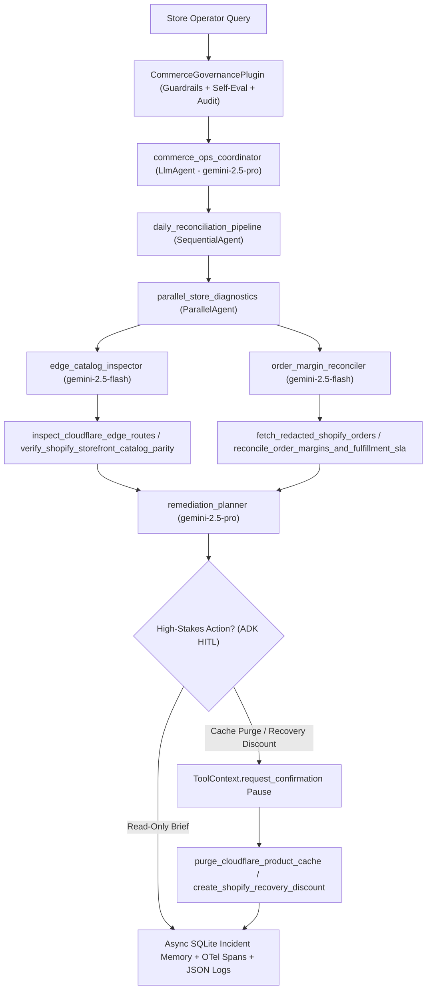

# Alotta Cake Commerce Operations & Edge Reconciliation Agent

[](https://github.com/agpalumbo/L200Agent/actions/workflows/ci.yml)

A bounded, multi-agent **Google Agent Development Kit (`google-adk`)** system built for **Alotta Cake** (`https://alottacake.com`). It continuously reconciles headless **Cloudflare Workers** storefront state against **Shopify** (`checkout.alottacake.com`) and Print-on-Demand fulfillment SLAs—while enforcing active **PII redaction**, **HMAC order pseudonymization**, **minor-unit integer margin math**, and **Human-in-the-Loop (HITL)** approval stops before any edge cache purge or customer recovery discount mutation.

---

## 1. Problem & Architecture

Modern headless e-commerce splits operational truth across three systems:
1. **Cloudflare Workers (`alottacake.com`)** renders SSR storefront routes (`/`, `/products/*`, `/studio`).
2. **Shopify (`checkout.alottacake.com`)** owns authoritative product/variant pricing, discounts, and paid orders.
3. **Print-on-Demand Fulfillment** holds orders in manual-confirmation drafts until verified.

Without a governed operations agent, stale edge caches cause storefront-vs-checkout price drift, unconfirmed fulfillment drafts breach shipping SLAs, promo stacking erodes SKU contribution margins, and naive LLM integrations leak customer PII into logs and prompts.



---

## 2. AgentOps Design Highlights

* **Tool & Interface Design:**
  * Explicit Pydantic v2 input/output schemas (`extra="forbid"`) in `commerce_ops_agent/schemas/`.
  * Domain-specific verb-noun tools (`inspect_cloudflare_edge_routes`, `verify_shopify_storefront_catalog_parity`, `fetch_redacted_shopify_orders`, `reconcile_order_margins_and_fulfillment_sla`, `purge_cloudflare_product_cache`, `create_shopify_recovery_discount`).
  * Structured `GuidedToolError` responses providing concrete `recovery_instruction` steps back to the LLM on upstream HTTP or validation failures.
* **Context & Memory:**
  * Constitutional System-of-Record boundaries in `commerce_ops_agent/constitution.py`.
  * ADK `EventsCompactionConfig`, `ContextCacheConfig`, and `ContextFilterPlugin` in `commerce_ops_agent/agent.py`.
  * Persistent `DatabaseSessionService` + SQLite `PersistentIncidentMemoryStore` in `commerce_ops_agent/memory/session_store.py`.
  * Non-blocking `asyncio.create_task` background consolidation in `commerce_ops_agent/memory/async_consolidator.py`.
* **Orchestration & Logic:**
  * Multi-agent hierarchy combining `LlmAgent` coordinator, `ParallelAgent` concurrent diagnostics, and `SequentialAgent` remediation pipeline.
  * Strategic model routing: `gemini-2.5-flash` for low-latency inspection/reconciliation fan-out; `gemini-2.5-pro` for multi-system synthesis and governance planning.
  * `CommerceGovernancePlugin(BasePlugin)` enforcing prompt-injection defense, output PII self-evaluation, a hard `<= 20%` recovery discount ceiling, and `/products/*` URL-only cache purge rules.
  * Native ADK `ToolContext.request_confirmation(...)` Human-in-the-Loop stops on all write tools.
* **Observability & Tracing:**
  * Cloud Logging–compatible structured JSON logs (`python-json-logger`) with zero `print()` statements.
  * Paired `TOOL_INTENT` (pre-call) and `TOOL_OUTCOME` (post-call) audit records.
  * OpenTelemetry `TracerProvider` and `@traced_operation` spans across tools, adapters, memory, and PII scrubbing.
  * Active PII scrubbing (`google-cloud-dlp` + deterministic regex + HMAC `ord_<12hex>` pseudonymizer) in `commerce_ops_agent/security/pii_redactor.py`.
* **Infrastructure & CI/CD:**
  * Dual `COMMERCE_MODE=fixture|live` router enabling deterministic offline CI/evals and live Shopify Dev Dashboard (24h rotating Client Credentials) + Cloudflare Zone API execution.
  * `google-cloud-secret-manager` runtime secret injection in `commerce_ops_agent/config.py`.
  * Complete Terraform IaC in `terraform/` + automated golden-dataset regression harness in `tests/eval/` and `.github/workflows/ci.yml`.

---

## 3. Quick Start (ADK CLI & Local Development)

```bash
# 1. Create virtual environment and install dependencies
python3 -m venv .venv
source .venv/bin/activate
pip install -e ".[dev]"

# 2. Configure local environment (defaults to deterministic `fixture` mode)
cp .env.example .env

# 3. Run unit, multi-agent integration, and golden evaluation suites
pytest tests/unit tests/integration -v
pytest tests/eval -v

# 4. Launch the interactive ADK Dev UI or CLI runner
adk web .
# or:
adk run commerce_ops_agent
```

### Deploying to Google Cloud (Terraform + ADK CLI / Agent Starter Pack)

```bash
# Provision Secret Manager, Artifact Registry, least-privilege IAM, and Cloud Run
cd terraform
terraform init
terraform plan -var="project_id=your-gcp-project-id"
terraform apply -var="project_id=your-gcp-project-id"

# Or deploy directly via ADK CLI to Cloud Run / Vertex AI Agent Engine
adk deploy cloud_run \
  --project=your-gcp-project-id \
  --region=us-central1 \
  --service_name=alottacake-commerce-ops \
  commerce_ops_agent
```
